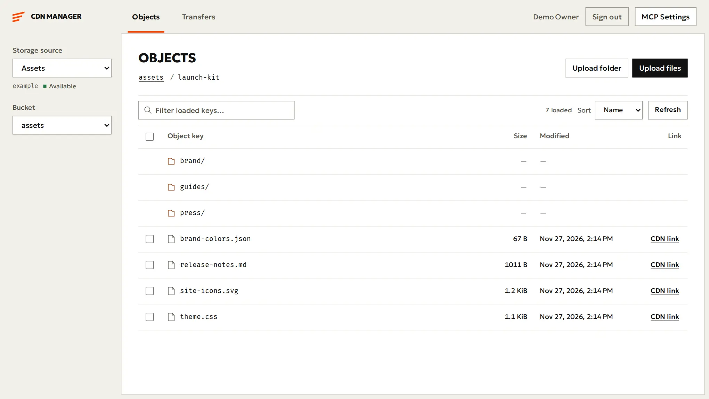
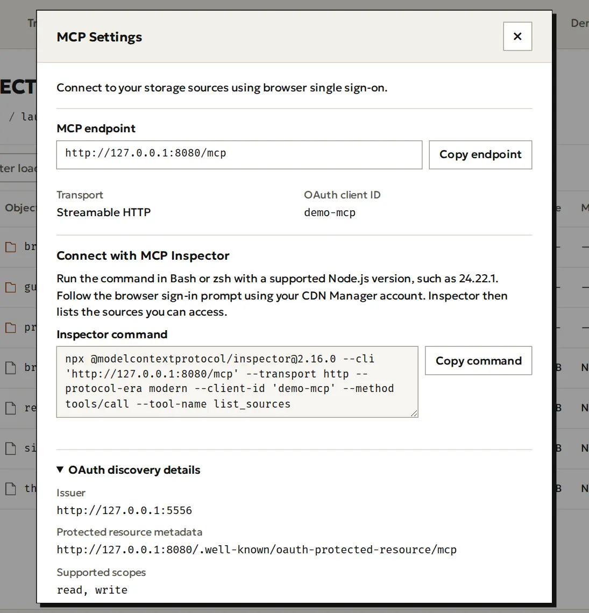

# CDN Manager

CDN Manager is a self-hosted file manager for S3-compatible storage. Sign in, choose a storage source and bucket, and share a permanent CDN link. An MCP client signed in as the same user sees the same sources and generates the same links. Recipients open those links without an account through a separate CDN gateway, even when the manager is offline.



## Try it with Docker Compose

From a clean checkout with Docker and the Compose plugin installed, start the manager, a demo identity provider, two private Garage buckets, and the NGINX gateways.

```sh
docker compose up -d --build --wait
```

1. Open [CDN Manager](http://127.0.0.1:8080/), select **Continue with single sign-on**, and choose **Demo Owner**.
2. Select **Assets** under **Storage source** and use **Upload files** to choose a small file. Wait for the transfer to complete, then return to **Objects**.
3. On your file's row, select **CDN link**, then **Copy link**. Open that URL in a private browser window to read the file through the local CDN.
4. Try **Media** with a larger file. To resume an interrupted multipart upload, open **Transfers** and select the original local file when prompted.

The example CDN listens on port 8081. **Assets** uses the root path and **Media** uses `/media/`. The manager, identity provider, and CDN bind to loopback and use demo accounts and credentials. Run `docker compose down` to stop the demo and retain its storage volumes.

## Connect an MCP client

1. Sign in to CDN Manager and open **MCP Settings**.
2. Select **Copy command** and run the command in Bash or zsh with a compatible Node.js version. The demo flow was verified with Node.js 24.22.1 and MCP Inspector 2.16.0.
3. Follow Inspector's browser sign-in prompt and choose **Demo Owner** for Compose or your usual account for an Authentik deployment. The client performs the OAuth exchange and calls `list_sources` to display the sources your account can access.

The settings panel also shows the endpoint, Streamable HTTP transport, and registered OAuth client ID. Expand **OAuth discovery details** for the issuer, protected resource metadata URL, and supported scopes. [Register the OAuth clients and connect Inspector through Authentik](docs/mcp-authentik.md).



## Storage and sharing

- **Browse files.** Navigate prefixes, load additional pages, filter loaded keys, and sort the loaded results. Inspect object metadata, download individual files, or stream selected files as a ZIP. Bulk deletion reports failures per object.
- **Upload files and folders.** Sources with multipart enabled support progress, part retries, and recovery across manager restarts with a persistent state volume. The manager keeps the upload session in its journal and checks S3 for completed parts before resuming.
- **Edit text.** Edit supported text formats such as JSON and CSS up to 1 MiB on sources that support atomic conditional writes. A conflicting save preserves the user's draft. Conditional writes are disabled in the Garage demo.
- **Share a permanent link.** The configured CDN route maps a key to its origin. Test its availability from the manager in the object's details. A separate, expiring S3 link requires presign permission and an S3 endpoint the recipient can reach.
- **Respect provider capabilities.** Object versions, bucket creation and deletion, and bucket policy editing depend on both the provider and the source configuration. [Provider compatibility matrix and parity gaps](docs/compatibility.md).

## Deploy

The Go server embeds the React interface and shares authorization and storage operations between [REST `/api/v1`](docs/openapi.yaml) and MCP `/mcp`. It writes to S3 on behalf of signed-in users. Configure a separate gateway to read from each private bucket and serve public requests. When routing by prefix, strip the routing prefix before signing the S3 request. Verify requests from the recipient's network, including byte ranges for video.

Set `CDN_MANAGER_CONFIG` to a JSON file. See the [Compose example](e2e/demo/config.json) and [Helm values](charts/cdn-manager/values.yaml) for the full structure.

| Setting | Purpose |
| --- | --- |
| `auth.publicUrl` | HTTPS origin of the manager. Register the exact origin plus `/auth/callback` as the web OAuth redirect URI. |
| `auth.oidcIssuer`, `oidcClientId`, `oidcClientSecretEnv` | Web OIDC provider, client ID, and client secret environment variable. The ID token must include the user's `groups` claim. |
| `auth.mcpIssuer`, `mcpAudience`, `mcpScopes` | MCP issuer, dedicated OAuth client ID used as the audience, and allowed scopes such as `read`, `write`, and `delete`. |
| `sources[].id`, `endpoint`, `region`, `pathStyle`, `buckets` | Stable ID, S3 endpoint, signing region, addressing style, and explicit bucket allowlist. |
| `sources[].accessKeyEnv`, `secretKeyEnv`, `sessionTokenEnv` | Environment variable names for S3 credentials. The session token is optional. |
| `sources[].roles`, `capabilities` | Identity-provider groups mapped to `viewer`, `editor`, and `admin`, plus explicitly enabled provider capabilities. |
| `sources[].cdnUrl`, `cdnProbeUrl` | CDN URL template with exactly one `{key}` in the path and an optional `{bucket}`. Set `cdnProbeUrl` if the manager reaches the gateway through a separate route. |
| `sources[].listingEncoding` | List response decoding. The default, `path`, preserves literal plus signs. Set `form` for SeaweedFS 4.55, which encodes spaces as plus signs. |

Viewers can read and share permanent CDN links. Editors can also upload and edit text. Admins can delete objects, create presigned links, and manage buckets when the source enables the operation. MCP requires both the source role and the scope for each tool call. The manager retains the S3 credentials server-side and audits mutations.

### Helm chart

Prepare a values file with your identity provider and sources, set `existingSecret` to the Secret that supplies the credential environment variables, and configure a TLS Secret if using the chart's Ingress. The default repository is `ghcr.io/therodev-corp/cdn-manager`. The chart selects the numbered release image by default. To follow a branch, set `image.tag` to `main` or `dev` and `image.pullPolicy` to `Always` so a new pod pulls the current image. For a local cluster, you can import the dev image described below and set `image.repository` to `cdn-manager` and `image.tag` to `dev`. Allow multipart requests up to 64 MiB and stream ZIP and download responses through the ingress controller.

```sh
kubectl create namespace cdn-manager
kubectl -n cdn-manager create secret generic cdn-manager-credentials \
  --from-env-file=/secure/path/cdn-manager.env
helm upgrade --install cdn-manager ./charts/cdn-manager \
  --namespace cdn-manager --values /secure/path/values.yaml
```

To install a packaged release, use `oci://ghcr.io/therodev-corp/charts/cdn-manager` in place of the local chart path and add `--version` with the matching published chart version. A stable Git tag such as `v0.1.0` publishes `ghcr.io/therodev-corp/cdn-manager:v0.1.0` and the chart's matching numeric alias `0.1.0`, alongside the chart and GitHub release. Pushes to `main` and `dev` update the corresponding GHCR tag after CI passes. Each tag resolves to one OCI image index with Linux amd64 and arm64 images. [CI and release workflow](.github/workflows/ci-release.yaml).

The runtime uses a scratch image with a CA certificate bundle and runs as UID/GID 65534. The chart uses a read-only root filesystem and a retained PVC for the multipart journal and part staging. Keep that volume writable and dedicate each state directory to one instance. For an existing claim owned by the previous UID/GID 65532, set all three `podSecurityContext` values (`runAsUser`, `runAsGroup`, and `fsGroup`) to 65532 until the volume is migrated.

### Health and metrics

The web and MCP listener defaults to `:8080`. The internal listener defaults to `:9090` and serves `/livez`, `/readyz`, `/metrics`, and `/sources/health`. Keep the internal listener on your monitoring network. Source health is tracked separately from manager readiness so a failed source leaves healthy sources usable.

Enable `serviceMonitor.enabled` if your monitoring stack supports the ServiceMonitor CRD. Import the [API, SSO and MCP dashboard](observability/grafana/api.json) and [source transfer dashboard](observability/grafana/transfers.json) with a Prometheus-compatible datasource. Public cache and playback metrics come from the CDN gateway.

## Build and test

Use Go 1.26.5, Bun 1.4.2, and Helm. Build the web assets before compiling or testing Go so the binary can embed them.

```sh
(cd web && bun install --frozen-lockfile && bun run build)
go vet ./...
go test -race ./...
helm lint charts/cdn-manager
helm template cdn-manager charts/cdn-manager
```

Install Node.js for Playwright and follow the [end-to-end acceptance guide](e2e/README.md) for the browser and media dependencies and the Compose tests. For a `dev` branch build, download the image artifact for your architecture from the corresponding Actions run, extract it, and load the enclosed archive, for example `docker load -i cdn-manager-linux-amd64.tar.gz`. The loaded image is tagged `cdn-manager:dev`.

Licensed under [Apache-2.0](LICENSE).
The bundled fonts use the SIL Open Font License 1.1. See [Geologica](web/public/assets/licenses/geologica-5.3.0.txt) and [Fira Mono](web/public/assets/licenses/fira-mono-5.3.0.txt).
